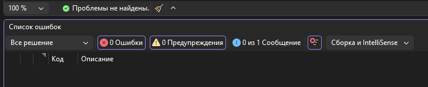
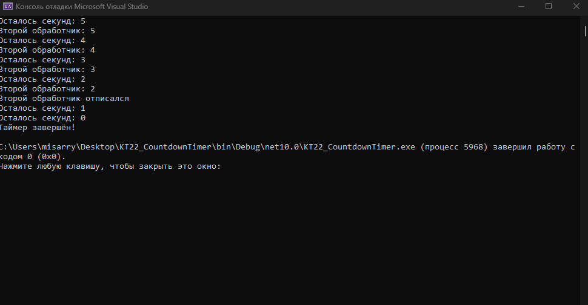

# КТ №22. Таймер обратного отсчёта

Вариант 1. Консольный проект на C# и .NET 10.

## Что делает программа

Таймер запускается на 6 секунд. Каждую секунду счётчик уменьшается, и событие Tick передаёт оставшееся время.

На Tick подписаны два обработчика. Первый выводит секунды до самого нуля. Второй тоже выводит секунды, но при значении меньше половины начального времени отписывается сам. После нуля событие Finished один раз выводит сообщение «Таймер завершён!».

При 6 секундах половина равна 3. Поэтому второй обработчик отписывается на 2, а на 1 и 0 работает только первый. В таблице задания есть опечатка: 3 не меньше половины от 6.

## Файлы

- Program.cs — создание таймера и обработчики событий.
- CountdownTimer.cs — класс таймера с методом Start и двумя событиями.
- KT22_CountdownTimer.csproj — настройки проекта.

## Проверка

Проект собран и запущен на .NET 10. Ошибок и предупреждений нет. Ниже скриншоты окна проверки: показан реальный вывод выполненных команд dotnet build и dotnet run.

Сборка:

Полный запуск:

